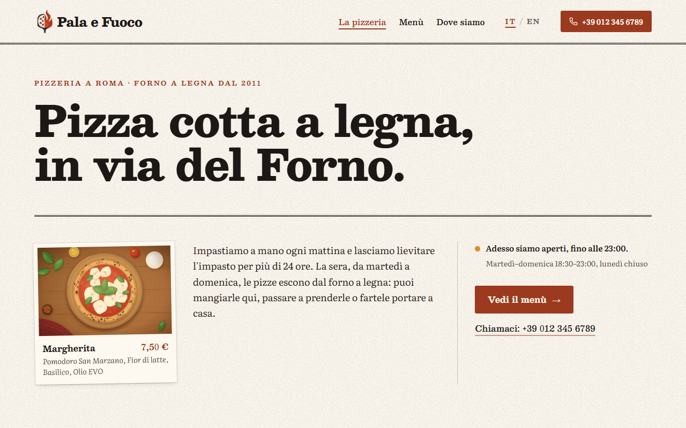
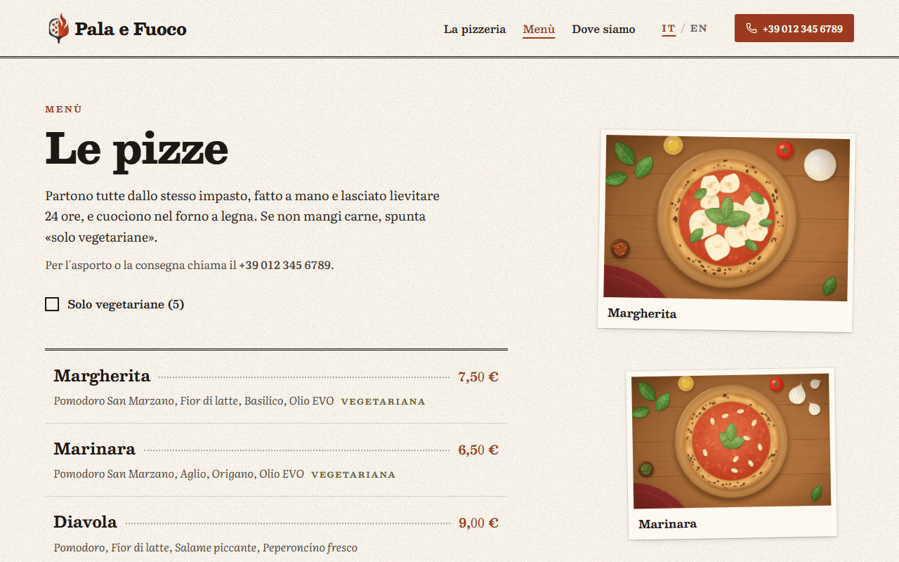
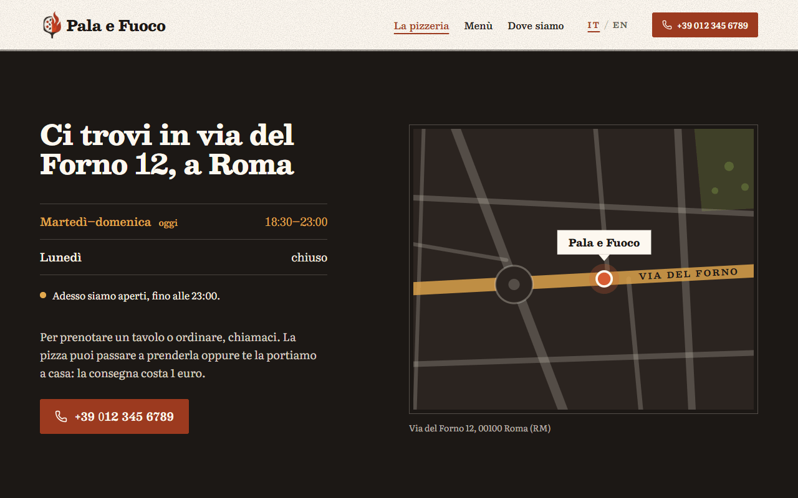
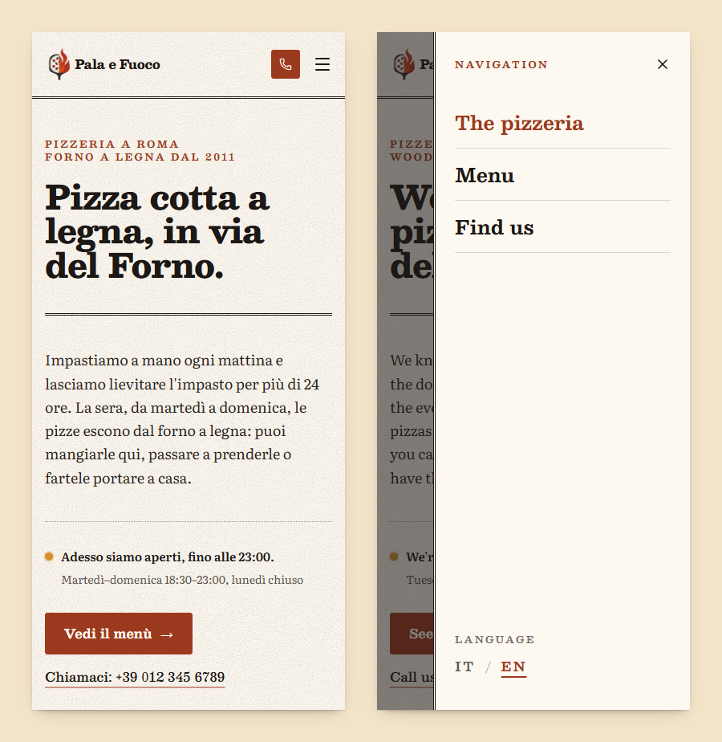

# Pala e Fuoco

Sito di una pizzeria di quartiere immaginaria, con **menù filtrabile, orari e stato di apertura in tempo reale**. Ha due pagine, la home e il menù, in italiano e inglese, con uno stile «da menù stampato» su fondo color carta.



**Demo online:** il sito è pubblicato con GitHub Pages; il link è nella sezione *About* di questo repository.

> **Progetto dimostrativo.** La pizzeria non esiste: nome, storia, indirizzo e telefono sono inventati e non c'è un backend. I pulsanti «Chiama» non avviano chiamate e la cartina è un disegno, non una mappa vera. L'unica cosa salvata nel browser è la lingua scelta.

## Funzionalità

- **Stato di apertura** calcolato sull'ora di Roma, non su quella del visitatore: «Adesso siamo aperti, fino alle 23:00», «Stasera apriamo alle 18:30» oppure «Adesso siamo chiusi: riapriamo domani alle 18:30». Si aggiorna da solo ogni 30 secondi; il giorno di chiusura la riga di oggi negli orari si evidenzia.
- **Menù** di 10 pizze con prezzo, ingredienti e illustrazione per le tre classiche, più il supplemento per l'impasto senza glutine. Il filtro «Solo vegetariane» mostra quante pizze troverebbe e annuncia il risultato ai lettori di schermo.
- **Link diretti alle pizze**: in home ogni nome porta alla sua voce nel menù (`/menu#diavola`), che si illumina per un attimo. Anche «Dove siamo» (`/#contatti`) funziona da qualunque pagina.
- **Riassunto del menù** in home ricavato dai dati: numero di pizze, quante sono vegetariane, la più economica e la più cara. Cambiando il menù il testo resta giusto.
- **Italiano e inglese** con un selettore di lingua, nella nav su desktop e nella sidebar su mobile. La scelta resta salvata nel browser. Prezzi (`7,50 €` / `€7.50`) e giorni cambiano con la lingua; gli orari restano in 24 ore.
- **Responsive**, da 320px in su: su mobile la nav si riduce a logo, pulsante «Chiama» e hamburger, che apre una sidebar con i link e il selettore di lingua (sotto i 375px il logo lascia il posto al solo nome); le illustrazioni del menù diventano una striscia orizzontale.
- **Accessibile**: contrasti WCAG AA, filtro con annuncio per i lettori di schermo, animazioni spente con «riduci movimento» attivo nel sistema.

| Menù | Contatti e orari |
|---|---|
|  |  |



## Tecnologie

[React 19](https://react.dev) · [TypeScript](https://www.typescriptlang.org) · [Vite](https://vite.dev) · [React Router](https://reactrouter.com) · [Tailwind CSS 4](https://tailwindcss.com) · [i18next](https://www.i18next.com) · [Motion](https://motion.dev) · [Lucide](https://lucide.dev) · [oxlint](https://oxc.rs)

## Avvio

Serve [Node.js](https://nodejs.org) 20.19+ o 22.12+.

```bash
npm install
npm run dev      # server di sviluppo su http://localhost:5173
npm run build    # controllo dei tipi + build di produzione in dist/
npm run preview  # serve la build di produzione
npm run lint     # oxlint
```

Per aprire il sito direttamente in una lingua: `http://localhost:5173/?lng=en`.

## Come funziona

Il sito non ha un backend: tutto quello che mostra viene da due file di dati, `src/data/info.ts` (contatti e orari) e `src/data/menu.ts` (le pizze), e dai testi in `src/locales/`.

### Stato di apertura

La pizzeria apre da martedì a domenica, dalle 18:30 alle 23:00, e chiude il lunedì. Gli orari stanno in `HOURS`, in `data/info.ts`; `getOpeningStatus()` li confronta con l'ora attuale e restituisce uno di tre stati:

| Stato | Quando | Frase mostrata |
|---|---|---|
| `open` | giorno di apertura, tra le 18:30 e le 23:00 | «Adesso siamo aperti, fino alle 23:00.» |
| `opens-tonight` | giorno di apertura, prima delle 18:30 | «Stasera apriamo alle 18:30.» |
| `closed` | dopo le 23:00 o nel giorno di chiusura | «Adesso siamo chiusi: riapriamo domani alle 18:30.» / «Oggi è lunedì e siamo chiusi: riapriamo domani alle 18:30.» |

Altri dettagli:

- **ora di Roma**: giorno e ora si leggono con `Intl.DateTimeFormat` nel fuso `Europe/Rome`, non in quello del visitatore. Chi apre il sito da Londra alle 18:00 vede «Adesso siamo aperti», perché in Italia sono le 19:00;
- **giorno di riapertura**: dopo la chiusura si cerca il primo giorno successivo che non sia quello di chiusura. La domenica sera il sito dice «riapriamo martedì», saltando il lunedì;
- **aggiornamento**: `useOpeningStatus` ricalcola lo stato ogni 30 secondi, così la pagina lasciata aperta passa da «Stasera apriamo» ad «Adesso siamo aperti» senza ricaricare;
- **niente testi nei dati**: lo stato contiene solo il tipo, il giorno di oggi e quello di riapertura. La frase la costruisce `OpeningStatus.tsx` con i testi della lingua attiva. Nella tabella degli orari dei contatti, la riga di oggi è evidenziata e porta la scritta «oggi»;
- **limite**: la chiusura deve cadere prima di mezzanotte. Con un orario come 19:00–01:00 l'una di notte risulterebbe «chiuso».

### Menù

Ogni pizza in `MENU` ha uno slug, il nome, il prezzo in euro, l'illustrazione (solo Margherita, Marinara e Diavola) e il segno «vegetariana». Gli ingredienti sono nei testi, alla chiave `menu.items.<slug>.ingredients`: `useMenu` li unisce ai dati nella lingua attiva.

- **Filtro «Solo vegetariane»**: nasconde le altre pizze e annuncia ai lettori di schermo quante ne restano («5 pizze mostrate»). Il numero tra parentesi nell'etichetta si conta dai dati.
- **Senza glutine**: l'impasto senza glutine non è una pizza ma un supplemento (`GLUTEN_FREE_PRICE`, 2 €). Chiude sempre l'elenco, anche con il filtro attivo, con il prezzo preceduto da «+».
- **Ancore**: ogni voce ha come `id` il proprio slug. In home i nomi delle pizze portano a `/menu#<slug>`: `useScrollToHash` fa scorrere la pagina fino alla voce, anche arrivando dalla home, e la voce si colora per un attimo (`animate-segna`). Lo stesso vale per «Dove siamo» (`/#contatti`) dal menù.
- **Riassunto in home**: «In carta ci sono 10 pizze, 5 vegetariane: si va dalla Marinara a 6,50 € alla 'Nduja e Burrata a 11,50 €». Numeri, pizza più economica e più cara si calcolano da `MENU`, quindi la frase resta giusta se il menù cambia.
- **Prezzi**: sono numeri e si formattano al momento con `Intl.NumberFormat` nella lingua attiva: `7,50 €` in italiano, `€7.50` in inglese.

### Contatti

Indirizzo e telefono sono fittizi. I pulsanti «Chiama» sono `<button>` senza azione, non link `tel:`: nessuna chiamata parte. Al posto di una mappa vera c'è una cartina disegnata in SVG (`StreetMap.tsx`), con via del Forno, un viale, una piazza, un giardino e il segnaposto della pizzeria. Per i lettori di schermo è un'immagine con l'indirizzo come descrizione.

## Struttura

```
src/
  main.tsx                 punto di ingresso: stile, i18n, router e App
  App.tsx                  rotte: / (home) e /menu
  PizzeriaLayout.tsx       nav, pagina e footer
  pizzeria.css             Tailwind con il tema della pizzeria (palette, font, grana della carta)
  assets/                  logo e illustrazioni delle pizze (WebP)
  components/
    PizzeriaNav.tsx        logo, link, pulsante «Chiama» e hamburger che apre la sidebar
    PizzeriaFooter.tsx     indirizzo, telefono e orari
    NavDrawer.tsx          sidebar della nav mobile (portale, focus, Esc, blocco dello scroll)
    LanguageSwitch.tsx     selettore IT/EN
    MenuRow.tsx            voce di menù con i puntini di guida; id = slug, usato come ancora
    PhotoPrint.tsx         illustrazione di una pizza trattata come una stampa, con didascalia
    OpeningStatus.tsx      riga «aperto / chiuso»
    StreetMap.tsx          cartina disegnata della zona (SVG)
    ui/Reveal.tsx          comparsa animata delle sezioni allo scroll
  data/
    menu.ts                le pizze: nome, prezzo in euro, illustrazione, vegetariana
    info.ts                indirizzo e telefono (fittizi), orari e getOpeningStatus()
  i18n/
    index.ts               configurazione di i18next
    locale.ts              lingua attiva e locale per Intl
  locales/
    it.json, en.json       tutti i testi del sito
  portfolio/               pillola «torna al portfolio», solo per chi arriva da flowsi.it
  pages/
    PizzeriaHome.tsx       home: apertura, storia, cosa c'è in carta, contatti
    PizzeriaMenu.tsx       menù con filtro e illustrazioni
  useHours.ts              giorni e orari nella lingua attiva
  useMenu.ts               menù con gli ingredienti nella lingua attiva
  useOpeningStatus.ts      stato di apertura, ricalcolato ogni 30 secondi
  useScrollToHash.ts       scroll alle ancore (#contatti, #margherita…) anche arrivando dall'altra pagina
public/favicon.webp        icona del sito
docs/screenshots/          immagini di questo README
.github/workflows/deploy.yml   pubblicazione automatica su GitHub Pages
```

Indirizzo, telefono e orari sono definiti una volta sola, in `src/data/info.ts`: nav, home, footer e stato di apertura li leggono da lì. Fanno eccezione il titolo della home e quello dei contatti («in via del Forno», «Ci trovi in via del Forno 12, a Roma»), che sono frasi dei testi e vanno aggiornati a mano. I giorni di apertura per esteso («martedì–domenica») stanno nei testi (`hours.openDays`) e vanno tenuti allineati a `HOURS.closedDay`.

## Arrivo dal portfolio

La demo fa parte del portfolio [flowsi.it](https://flowsi.it), che la apre con il parametro `?from=portfolio`. Solo in quel caso, in alto a sinistra, compare una pillola fissa che riporta al portfolio (`src/portfolio/`). Chi arriva da GitHub o da un link diretto non la vede.

- `fromPortfolio.ts`, importato in `main.tsx` prima del render, salva il segnale nel `sessionStorage` (chiave `portfolio:back`) e toglie `from` dall'URL. Così la pillola resta navigando tra le pagine della scheda, ma un link copiato non la porta con sé. Mette anche l'attributo `data-portfolio-back` su `<html>`.
- `BackToPortfolio.tsx` è la pillola, con i testi IT/EN al suo interno. Riporta sempre a `https://flowsi.it/#progetti`: l'indirizzo è fisso nel codice e non letto dall'URL, così nessuno può usarla per mandare altrove.
- Le classi con la variante `back:` (definita nel foglio di stile) valgono solo con quell'attributo: nell'header lasciano spazio alla pillola.

## Pubblicazione su GitHub Pages

Il workflow `.github/workflows/deploy.yml` pubblica il sito a ogni push sul branch `main`. Si può anche avviare a mano dalla scheda *Actions*. Il workflow installa le dipendenze, esegue il build e carica la cartella `dist/` su GitHub Pages.

Il sito viene servito da un sottopercorso, `https://<utente>.github.io/<nome-repository>/`. Per questo:

- il build riceve quel percorso come `base` (`--base=/<nome-repository>/`), letto dal nome del repository: se il repository viene rinominato, il workflow continua a funzionare;
- il router usa lo stesso percorso come `basename` (`import.meta.env.BASE_URL` in `main.tsx`);
- dopo il build, `dist/index.html` viene copiato in `dist/404.html`. GitHub Pages risponde con quella pagina a ogni percorso che non è un file, come `/pala-e-fuoco/menu`: così anche un link diretto o un ricaricamento sul menù aprono la pagina giusta.

Configurazione, una sola volta: *Settings → Pages → Build and deployment → Source: **GitHub Actions***.

## Lingua

La lingua viene scelta in quest'ordine: il parametro `?lng=it` / `?lng=en` nell'URL, poi la scelta fatta con il selettore (salvata nel `localStorage` alla chiave `pala-e-fuoco:lang`), infine la lingua del browser. Il parametro `lng`, una volta letto e salvato, viene tolto dall'URL (`src/i18n/index.ts`): l'indirizzo resta pulito e, ricaricando, non ha la precedenza su una scelta fatta poi con il selettore. Se nessuna corrisponde, il sito è in italiano.

I testi stanno in `src/locales/it.json` e `src/locales/en.json` (namespace `pizzeria`), con la stessa struttura di chiavi. `data/menu.ts` contiene solo nomi e prezzi: i nomi delle pizze sono nomi propri e restano uguali nelle due lingue, gli ingredienti stanno alla chiave `menu.items.<slug>.ingredients` e `useMenu.ts` li unisce ai dati. Lo stato di apertura (`getOpeningStatus`) non contiene frasi, solo uno stato: la frase la costruisce `OpeningStatus.tsx` con `t()`. I prezzi si formattano con `Intl`; l'inglese usa `en-GB`, con l'euro (`€7.50`). URL e ancore (`/menu`, `#contatti`) sono identificativi e restano uguali in tutte le lingue.

La lingua si può cambiare in qualsiasi momento: per questo nessun testo o formattatore viene calcolato una volta sola all'avvio, ma sempre al render (`useLocale()` in `src/i18n/locale.ts`).

Il tono è discorsivo: «noi», la pizzeria, che parla al cliente dando del «tu» (in inglese «you»). Un solo slogan: «Il resto lo fa il fuoco.» / «The fire does the rest.».

## Design

### Direzione visiva: «La carta»

Il sito imita il menù stampato che il cliente trova sul tavolo: fondo color carta con una grana leggera, inchiostro scuro, un secondo inchiostro terracotta, filetti orizzontali (anche doppi) al posto dei riquadri. Le illustrazioni delle pizze, viste dall'alto su un tagliere, sono trattate come stampe appoggiate sul foglio, con didascalia presa dal menù; le pizze senza illustrazione restano solo testo. Anche il selettore di lingua è «a stampa»: due voci di testo, quella attiva sottolineata come i link della nav. La cartina dei contatti è disegnata con gli stessi colori.

Da evitare: card con ombra morbida e icona, badge e pulsanti a pillola, gradienti decorativi, icone al posto delle immagini.

### Palette (`pizzeria.css`, `@theme`)

| Token | Valore | Uso |
|---|---|---|
| `crema-50` | `#fdf8f0` | fondo carta (dominante), cornice delle stampe |
| `crema-100` | `#faf1e2` | hover delle voci di menù, testo sulla fascia scura |
| `crema-200` | `#f3e3c8` | riservato |
| `terracotta-400…800` | `#e8734a` → `#7a2f1a` | secondo inchiostro: prezzi, link, pulsanti (`700`/`800`), frase grande, segnaposto della cartina |
| `basilico-500/600` | `#6b7a3a` / `#566130` | solo «vegetariana», filtro e giardino della cartina |
| `carbone-800/900` | `#2b2420` / `#1c1815` | testo; fascia serale (orari), cartina e footer |
| `grano-400/500` | `#e3a94d` / `#d3922e` | stato «aperto adesso», riga di oggi, evidenziazione, via del Forno sulla cartina |

Non introdurre colori fuori da questa tabella (neanche il bianco puro).

Contrasti misurati (WCAG AA = 4,5:1 per il testo normale):

| Combinazione | Contrasto |
|---|---|
| `carbone-800` su `crema-50` (testo) | 14,44:1 |
| `carbone-900` su `crema-50` (titoli) | 16,68:1 |
| `carbone-800/85` su `crema-50` (ingredienti) | 9,07:1 |
| `carbone-800/80` su `crema-50` (didascalie, riga degli orari) | 7,68:1 |
| `carbone-900/70` su `crema-50` (lingua non attiva) | 6,34:1 |
| `terracotta-700` su `crema-50` (prezzi, link, slogan) | 6,54:1 |
| `terracotta-700` su `crema-100` (prezzo della voce sotto il mouse) | 6,17:1 |
| `terracotta-700` su `grano-400/40` (voce raggiunta da un'ancora) | 5,03:1 |
| `basilico-600` su `crema-50` («Vegetariana») | 6,31:1 |
| `crema-50` su `terracotta-700` (pulsanti) | 6,54:1 |
| `crema-50` su `terracotta-800` (pulsanti, hover) | 8,83:1 |
| `crema-50` su `terracotta-600` (pulsante dei contatti, hover) | 4,64:1 |
| `crema-100` su `carbone-900` (fascia degli orari) | 15,74:1 |
| `crema-100/85` su `carbone-900` (testo dei contatti) | 11,59:1 |
| `grano-400` su `carbone-900` (riga di oggi) | 8,44:1 |
| `crema-100/75` su `carbone-900` (footer) | 9,25:1 |
| `crema-100/50` su `carbone-900` (© nel footer) | 4,80:1 |
| `carbone-900` su `grano-400/80` (via del Forno sulla cartina) | 6,02:1 |

La grana della carta scurisce il fondo in modo appena percettibile e non cambia questi valori in modo rilevante. Il punto di stato «chiuso» (un cerchio vuoto) e la barra tra IT ed EN sono decorativi: lo stato è sempre scritto per esteso.

### Font

- `font-display`: **Besley** (Clarendon variabile) per titoli, nomi delle pizze, prezzi, etichette.
- `font-text`: **Literata** (serif da lettura, asse `opsz` automatico) per il testo; il corsivo per ingredienti e didascalie.

## Licenza

Distribuito con licenza [MIT](LICENSE).
